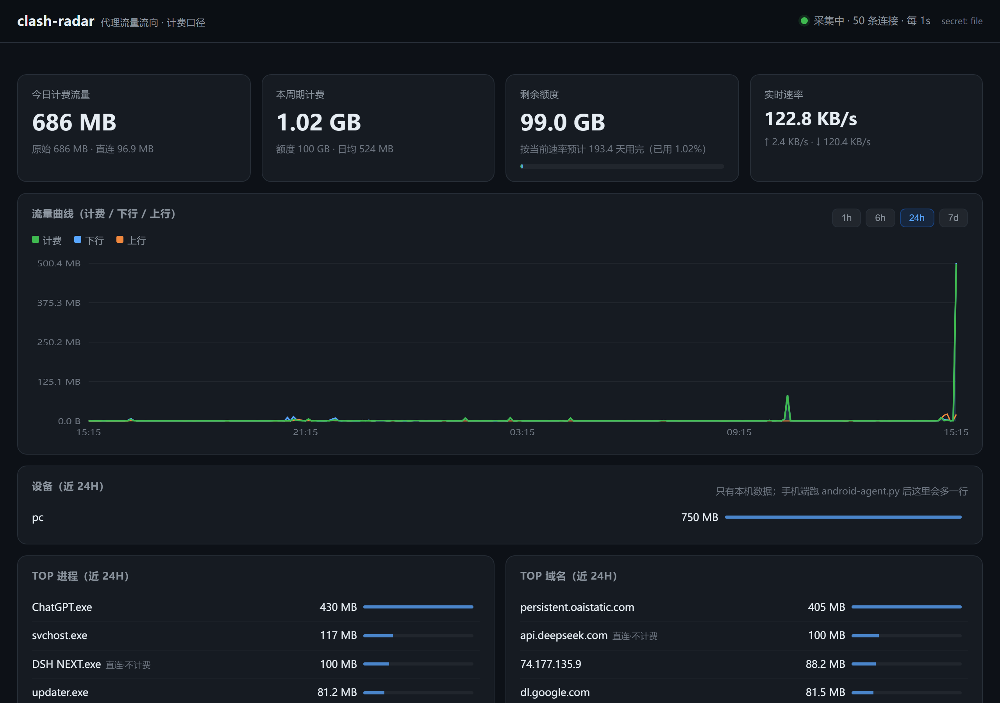
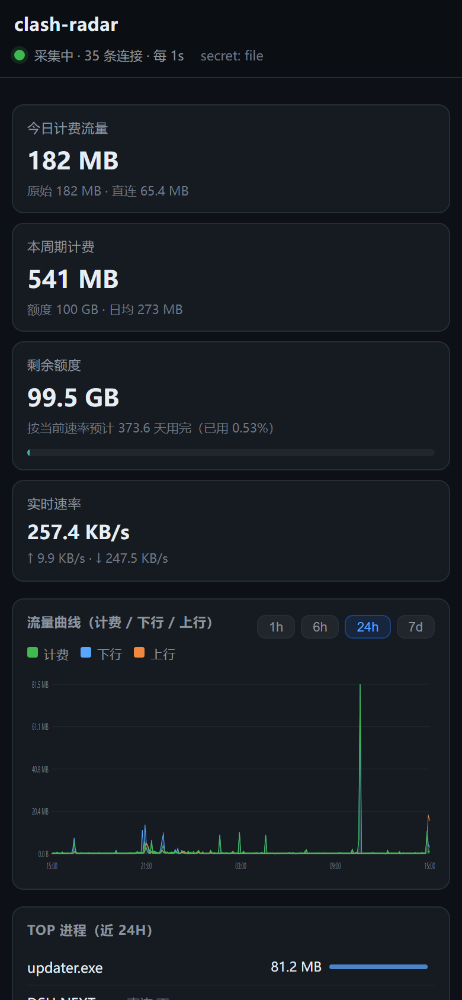

# clash-radar

> 仓库：[ussumer/network-supervisor](https://github.com/ussumer/network-supervisor) ｜ 工具名：clash-radar

把「机场流量到底被谁吃了」变成一张能看的账。



它每秒读一次 mihomo 内核的 `/connections`，把每条连接的累计字节差分成增量，按 **进程 / 域名 / 节点 / 规则** 记账，再按节点倍率换算成**机场实际计费流量**，最后用单页看板展示。纯旁路只读：不改你的订阅、不碰节点、不代理任何流量。

---

## 快速开始（新机器）

```powershell
git clone https://github.com/ussumer/network-supervisor.git
cd network-supervisor
powershell -ExecutionPolicy Bypass -File scripts\setup-windows.ps1
```

脚本依次做四件事：找客户端配置目录 → 探测控制器端口 → 生成 `.env` → `docker compose up -d --build`，最后等到健康检查通过并打印地址。

手动部署也行：

```powershell
copy .env.example .env          # 改 FLCLASH_DIR 和 CLASH_API
docker compose up -d --build
```

打开 <http://127.0.0.1:8787>。

**支持的客户端**：FlClash（默认 9090）、Clash Verge Rev（默认 9097）、Clash Nyanpasu 等一切 mihomo 内核客户端。secret 从配置目录里自动扫，扫不到就在 `.env` 里填 `CLASH_SECRET`。

首次启动会先「打基线」（只记录当前连接的累计值，不计入统计），所以前几秒数字是 0，属正常。

停止 / 卸载：

```powershell
docker compose down        # 停容器，保留数据
docker compose down -v     # 停容器并删除数据卷
```

---

## 数据从哪来

| 项 | 说明 |
|---|---|
| 数据源 | `http://host.docker.internal:9090/connections`（FlClash 内置的 mihomo 控制器） |
| 鉴权 | `Authorization: Bearer <secret>`，secret 从 `shared_preferences.json` 自动读取 |
| 频率 | 默认 1 秒一次，`POLL_INTERVAL` 可调 |
| 写入 | 单文件 SQLite（WAL），存放在命名卷 `radar-data` |
| 本机流量开销 | 轮询走 Docker 内部通道，**不经过代理，不消耗机场流量** |

### 三个必须知道的口径

1. **计费流量 = (上传 + 下载) × 节点倍率**，`DIRECT` / `REJECT` 的连接一分钱都不算。
   少数机场只算下行，把设置页的「计费口径」改成「只算下载」即可。
2. **连接关闭时的那一小段尾巴**：两次轮询之间连接就断了，per-connection 计数器再也读不到。
   这时用内核的全局计数器补差（`uploadTotal`/`downloadTotal`），把差额按最后看到的连接归因；实在归不上的落到 `(unattributed)`。
   实测 20 MB 下载的记账误差 **-0.007%**。
3. **容器重启不会重复记账**：启动第一轮只建立基线，不会把长连接的历史累计值再加一遍。

---

## 页面怎么看

- **今日 / 本周期计费**：按倍率换算后的真实扣费量，和机场面板同口径
- **剩余额度**：进度条 + 「按当前速率预计几天用完」，这是比面板更早的预警
- **流量曲线**：计费 / 下行 / 上行三条线，1h / 6h / 24h / 7d
- **Top 进程 / 域名 / 节点 / 规则**：近 24h，按计费流量排序，带占比条
- **实时连接**：正在跑的连接，进程 → 域名 → 节点链，一眼看出哪条规则放行的
- **设置**：额度、计费口径、周期，以及**节点倍率表**（正则 → 倍率，改完历史数据立刻按新倍率重算）

手机竖屏已适配，浏览器直接开就能看：



排版出问题时可在地址后加 `?debug=1`，页面标题会打印实际视口宽度和最宽元素，方便定位。

倍率表写法（一行一条，按顺序匹配，先匹配先赢）：

```
^GBR.*  2.0
^HKG.*  1.5
.*      1.0
```

---

## 配置

`.env`（全部可选，括号内为默认值）：

| 变量 | 说明 |
|---|---|
| `FLCLASH_DIR` | FlClash 配置目录（用于读取 secret），默认 `C:/Users/34114/AppData/Roaming/com.follow/clash` |
| `CLASH_API` | 控制器地址（`http://host.docker.internal:9090`） |
| `CLASH_SECRET` | 手动指定 secret（自动读取失败时用） |
| `PORT` | 看板端口，默认 `8787`，只绑定 `127.0.0.1` |
| `BUDGET_GB` | 套餐额度，默认 `100` |
| `BILLING_MODE` | `updown`（默认）/ `down` |
| `POLL_INTERVAL` | 轮询间隔秒，默认 `1` |
| `TZ_OFFSET_HOURS` | 时区偏移，默认 `8`（北京时间） |
| `DETAIL_RETENTION_DAYS` | 明细保留天数，默认 `30` |

额度、口径、周期、倍率改过之后存在数据库里，重启不丢；环境变量只作为首次运行的默认值。

---

## 手机上报（Android + Termux）

看板默认只统计跑着它的那台机器。手机要单独采，用一个纯标准库的小 agent，数据按设备名汇总进同一张表。

**1. PC 端 `.env`**

```
BIND_ADDR=0.0.0.0            # 让手机能连进来（默认 127.0.0.1 只允许本机）
INGEST_TOKEN=<随机串>         # 上报口令，手机端 --token 用这个
DASHBOARD_TOKEN=<随机串>      # 可选：看板访问口令，设了就用 /?k=口令 打开一次
```

改完 `docker compose up -d`。

**2. 手机（Termux）**

```bash
pkg install -y python
curl -O https://raw.githubusercontent.com/ussumer/network-supervisor/main/scripts/android-agent.py
python android-agent.py --server http://<PC内网IP>:8787 --token <INGEST_TOKEN>
```

**3. 后台常驻**

```bash
termux-wake-lock
nohup python android-agent.py --server http://<PC内网IP>:8787 --token <INGEST_TOKEN> > ~/radar.log 2>&1 &
```

前提：手机里的 Clash 客户端要开着「外部控制器」。ClashMetaForAndroid 在 设置 → 网络 → 外部控制器，默认 `127.0.0.1:9090`，agent 默认就读这个地址；客户端如果设了 secret，用 `--secret` 传。

看到 `[ok] 已上报 N 行` 就说明通了，看板「设备」一栏会多出一行，**总额是各设备之和**——这才是机场账号的真实消耗。

限制：iOS 没有对应方案（Shadowrocket 不支持脚本），只能用 Stash/Surge 自己写；手机和 PC 要在同一局域网，或者都连 Tailscale。

---

## 和机场面板对账

在宿主机跑一次受控下载，比较两边增量：

```powershell
$secret = '<你的 secret>'
$h = @{ Authorization = "Bearer $secret" }
$a0 = Invoke-RestMethod 'http://127.0.0.1:9090/connections' -Headers $h
$d0 = Invoke-RestMethod 'http://127.0.0.1:8787/api/overview'
docker run --rm curlimages/curl:latest -s -x http://host.docker.internal:7896 `
  -o NUL -w 'downloaded=%{size_download}\n' 'https://speed.cloudflare.com/__down?bytes=20000000'
Start-Sleep 4
$a1 = Invoke-RestMethod 'http://127.0.0.1:9090/connections' -Headers $h
$d1 = Invoke-RestMethod 'http://127.0.0.1:8787/api/overview'
"api delta      = $(($a1.uploadTotal+$a1.downloadTotal) - ($a0.uploadTotal+$a0.downloadTotal))"
"dashboard delta = $(($d1.today.raw+$d1.today.direct) - ($d0.today.raw+$d0.today.direct))"
```

如果两边差得远，优先检查：节点倍率（设置页）、计费口径（上/下行）、以及是否有**别的设备**在共用订阅。

---

## 常见问题

**顶栏红点 / 401**
secret 变了或路径不对。从 FlClash 的 `config.yaml` 里抄 `secret:` 到 `.env` 的 `CLASH_SECRET`，再 `docker compose up -d`。

**数字一直是 0**
FlClash 没在跑，或控制器端口不是 9090。`docker compose logs` 会显示具体报错。

**比机场面板少**
本工具只看得到本机。手机、平板、路由器上跑的那部分它看不见——那要去机场面板的「在线设备 / IP」查。另外倍率、计费口径不一致也会造成差异。

**某个进程完全没出现**
说明它的流量没经过内核（比如 qBittorrent 配了 DIRECT 规则、或 TUN 关闭时没走系统代理的软件）。这类流量不产生机场费用，**没出现是好事**。

**时间对不上**
改 `TZ_OFFSET_HOURS`（北京时间 8）。

---

## 运维

```powershell
docker compose logs -f                      # 日志
docker compose restart                      # 重启（数据不丢）
docker compose up -d --build                # 改了代码后重建
docker run --rm -v clash-radar_radar-data:/d -v ${PWD}:/backup alpine `
  tar czf /backup/radar-backup.tgz -C /d .  # 备份数据库
```

明细表按 `DETAIL_RETENTION_DAYS` 每小时自动清理，日级汇总不受影响（当前版本只保留明细，30 天足够定位问题）。

## 安全

- 看板只绑定 `127.0.0.1`，局域网访问不到
- FlClash 目录只读挂载，容器只能读 secret，改不了你的配置
- 容器 `read_only` 根文件系统 + `no-new-privileges` + 非 root (uid 10001)
- secret 具备控制器全部权限（可切节点），不要外泄；看板本身不提供任何写代理的接口

## 目录结构

```
network-supervisor/          # 仓库根目录
├─ docker-compose.yml
├─ Dockerfile
├─ .env.example
├─ scripts/
│  ├─ setup-windows.ps1      # 一键探测 + 生成 .env + 启动
│  └─ android-agent.py       # 手机端（Termux）采集上报
├─ app/
│  ├─ config.py      # 环境变量
│  ├─ collector.py   # 轮询 / 差分 / 残余归因 / 重连
│  ├─ store.py       # SQLite：分钟桶、倍率、聚合查询
│  ├─ main.py        # HTTP 服务 + JSON API + 周期计算
│  └─ static/        # 单页看板（零依赖，手写 SVG 图表）
└─ tests/            # 19 个单元测试
```

跑测试：

```powershell
python -m unittest discover -s tests -v
```
